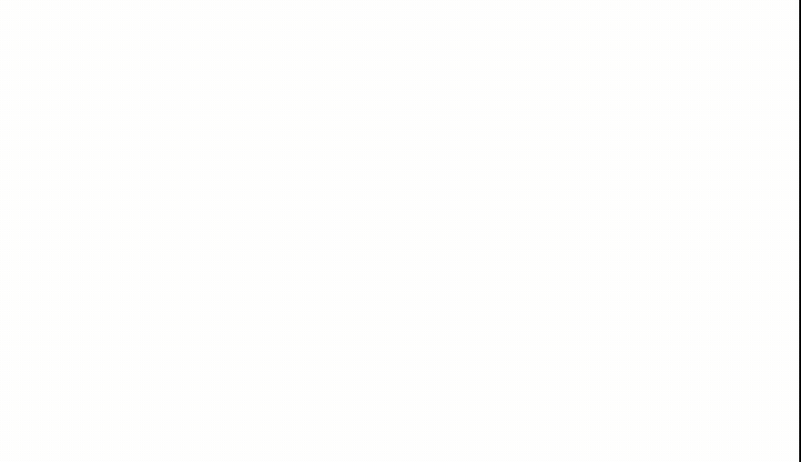

<div align="center">

# react-glass-lens

Lente de vidro arrastável em WebGL2 para React. Refração por pixel no DOM abaixo, com dispersão cromática, presets e captura ao vivo via HTML-in-Canvas.

**[Demo ao vivo](https://lenderson00.github.io/react-glass-lens/)**

[](LICENSE)




</div>

## Visão geral

`react-glass-lens` envolve seu conteúdo React em um palco com uma lente circular que refrata o que está embaixo. O efeito vem de um fragment shader WebGL2 que aplica a lei de Snell nas superfícies curva e plana de um domo de vidro, com amostragem espectral onde as cores se separam. Mover a lente custa essencialmente uma draw call; o DOM continua interativo.

## Recursos

- Refração física por pixel (não é blur nem `transform: scale`)
- Dispersão cromática configurável (`aberration`, `spectralSamples`)
- Qualquer conteúdo React no palco, com estado, foco e clique preservados
- Modos `drag`, `follow` e `static`, com inércia e suavização
- Seis presets: `crystal`, `orb`, `magnifier`, `droplet`, `subtle`, `liquid`
- Vidro fosco (`frost`), sombra, Fresnel e luz direcional
- Captura `snapshot` (compatível) ou `html-in-canvas` (pixels ao vivo, com fallback)
- TypeScript, ~13 kB gzip, ESM + CJS

## Instalação

```sh
npm i react-glass-lens
```

Peer dependencies: React 18 ou 19.

## Uso

```tsx
import { LensStage } from 'react-glass-lens';

export function Hero() {
  return (
    <LensStage style={{ height: 480 }}>
      <SeuConteudo />
    </LensStage>
  );
}
```

`LensStage` é um contêiner `position: relative`. Defina altura/largura no palco. Props individuais sobrescrevem `config` (preset):

```tsx
import { LensStage, lensPresets } from 'react-glass-lens';

<LensStage config={lensPresets.liquid} frost={0.25}>
  <SeuConteudo />
</LensStage>;
```

### Presets

| Preset | Comportamento |
| --- | --- |
| `crystal` | Padrão: zoom, borda curva, franja cromática |
| `orb` | Esfera: inversão perto da borda |
| `magnifier` | Lupa com centro plano |
| `droplet` | Gota, IOR ~1.33 |
| `subtle` | Refração discreta |
| `liquid` | Vidro de UI, estilo Liquid Glass (sem afiliação Apple) |

### Props principais

| Prop | Padrão | Descrição |
| --- | --- | --- |
| `radius` | `258` | Raio da lente (px) |
| `magnification` | `1.75` | Zoom no centro |
| `ior` | `1.52` | Índice de refração |
| `aberration` | `0.054` | Dispersão (0 desliga) |
| `frost` | `0` | Desfoque interno (0 a 1) |
| `mode` | `'drag'` | `drag` / `follow` / `static` |
| `capture` | `'snapshot'` | `snapshot` / `html-in-canvas` / `auto` |
| `captureBudget` | `0.3` | Cota de CPU no modo snapshot (0.05 a 0.9) |

Tabela completa, callbacks e API imperativa: [documentação no site](https://lenderson00.github.io/react-glass-lens/#/docs).

## HTML-in-Canvas (experimental)

No modo padrão o palco é clonado para textura quando o DOM muda. Com a [proposta HTML-in-Canvas](https://github.com/WICG/html-in-canvas) o palco vira `<canvas content="drawable">`, filhos marcados com `drawable`, loop `requestPaint()` + evento `paint`, e upload via `texElementSubImage2D()` no WebGL2. A geometria de hit test é sincronizada com `updateElementGeometry()`.

```tsx
import { LensStage, supportsHtmlInCanvas } from 'react-glass-lens';

<LensStage capture="html-in-canvas">
  <ConteudoAnimado />
</LensStage>;

supportsHtmlInCanvas(); // feature detection
```

A API é experimental (Chromium, flag `CanvasDrawElement`). Onde não existir, ou em caso de erro, o componente volta ao snapshot. Neste repositório testamos com `--enable-blink-features=CanvasDrawElement`: `requestPaint`, `texElementSubImage2D` e upload funcionaram; o atributo legado `layoutsubtree` foi removido do código.

## Como funciona

1. **Captura:** o palco vira textura (clone DOM via SVG `foreignObject` no snapshot, ou compositor no html-in-canvas), com mipmaps.
2. **Shader:** traço de raio por pixel no domo; centro com `magnification` exato; borda com compressão e inversão.
3. **Dispersão:** múltiplos comprimentos de onda só onde há separação de cor.
4. **Movimento:** apenas uniforms mudam; a textura atualiza em mutações, fim de transições, fontes e tema.

## Performance (Chrome, referência)

| Cenário | Resultado típico |
| --- | --- |
| Arrastar lente | ~60 fps |
| Shader (~820 px) | ~0,4 ms GPU |
| Captura snapshot | ~13 ms (clone só estilos visuais) |
| Conteúdo em movimento sob a lente | lente 10 a 15 Hz com `captureBudget` 0.3 |

## Limitações

- Lente circular apenas (sem formato pílula).
- Snapshot: animações contínuas sem mudança de DOM precisam de `refreshInterval` ou `ref.refresh()`.
- Imagens cross-origin precisam de CORS na captura.
- Sem WebGL2: conteúdo normal, `onError` dispara, lente oculta.

## Documentação e playground

**[lenderson00.github.io/react-glass-lens](https://lenderson00.github.io/react-glass-lens/)** (docs, demos, playground com código exportável)

```sh
git clone https://github.com/lenderson00/react-glass-lens.git
cd react-glass-lens
npm install
npm run dev
```

Servidor local: http://localhost:5199 (`#/`, `#/docs`, `#/playground`).

## Repositório

```
packages/react-glass-lens/   pacote npm
src/site/                    site Vite
src/playground/              playground
```

| Comando | Ação |
| --- | --- |
| `npm run dev` | Site local |
| `npm run build` | Lib + site |
| `npm run typecheck` | Typecheck |

## Contribuindo

Issues e PRs são bem-vindos. Antes de abrir PR: `npm run typecheck && npm run build`.

## Licença

[MIT](LICENSE) © Lenderson Macedo